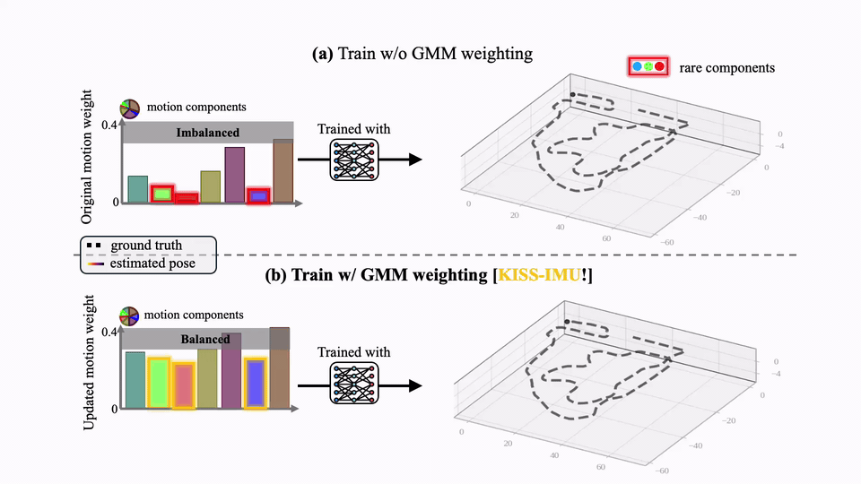

<div align="center">
  <h1>
    KISS-IMU: Self-supervised Inertial Odometry <br>
    with Motion-balanced Learning and Uncertainty-aware Inference
  </h1>
  <a href="https://github.com/sparolab"></a>
  <a href="https://sparolab.github.io/research/kiss_imu/"></a>
  <a href="https://arxiv.org/abs/2603.06205"></a>
  <a href="https://www.youtube.com/watch?v=cjAFROi-jG0"></a>
  <br />
  <a href="#-which-code-do-i-want"></a>
  <a href="https://github.com/sparolab/KISS-IMU/tree/icra2026"></a>
  <a href="#-getting-started"></a>
  <a href="https://pytorch.org"></a>
  <a href="#-license"></a>
  <br />

  <h3>🏆 IEEE ICRA 2026 Award Finalist</h3>

  <a href="https://scholar.google.com/citations?user=wL8VdUMAAAAJ&hl=ko" target="_blank">Jiwon Choi</a>,
  <a href="https://hogyun2.github.io" target="_blank">Hogyun Kim</a>,
  <a href="https://scholar.google.com/citations?user=kiBTkqMAAAAJ&hl=ko" target="_blank">Geonmo Yang</a>,
  <a href="https://scholar.google.com/citations?user=4-5Fi9kAAAAJ&hl=ko" target="_blank">Juhui Lee</a>,
  <a href="https://scholar.google.com/citations?user=W5MOKWIAAAAJ&hl=ko" target="_blank">Younggun Cho</a><sup>†</sup>

  **[🤖 Spatial AI and Robotics Lab (SPARO)](https://sparolab.github.io/)**

  <p align="center"></p>

  ***\<Keep IMU Stable and Strong\>***
</div>

---

## 📢 Which code do I want?

| | Branch | What it does |
| --- | --- | --- |
| 🆕 **Updated KISS-IMU** | [`main`](https://github.com/sparolab/KISS-IMU/tree/main) (this page) | The KISS-IMU idea run **online on a single run**: the robot drives the first **30 s** on the raw IMU, learns the denoiser from that stretch's own LiDAR-odometry pseudo-labels (GMM motion balancing + overlap-score label vote), then the running **sliding-window LiDAR-inertial PGO** switches to the corrected IMU for the rest of the run. No GT, no separate training set. |
| 📄 **Paper code (ICRA 2026)** | [`icra2026`](https://github.com/sparolab/KISS-IMU/tree/icra2026) (tag [`v1.0-icra2026`](https://github.com/sparolab/KISS-IMU/releases/tag/v1.0-icra2026)) | Exactly the code used for the paper: offline training on whole training sequences, evaluation on held-out sequences, PVGO inference. Use this to **reproduce the paper's numbers**. |

> **TL;DR** — reproducing the paper → `git checkout icra2026`. Wanting to *use* KISS-IMU the way the paper argues (learn from the start of the run → online PGO) → stay on `main`.

## 📰 News
- 🆕 **Nov 2026.** `main` now hosts the **updated online KISS-IMU** (warm-start on the first 30 s + sliding-window PGO). The paper code moved to the [`icra2026`](https://github.com/sparolab/KISS-IMU/tree/icra2026) branch.
- 🥇 **Jun 2, 2026.** Received the **IEEE-RAS Outstanding WiRA Student Paper Award at ICRA 2026**.
- 🏆 **May 6, 2026.** Selected as an **IEEE ICRA 2026 Award Finalist**.
- 🎉 **Jan 31, 2026.** Accepted to **IEEE ICRA 2026**.

## 💡 Overview

<p align="center"></p>

KISS-IMU denoises the raw IMU against a self-generated LiDAR-odometry pseudo-label. The updated version does it **inside one run**, with nothing prepared beforehand:

1. **Warm-up (0 → 30 s).** The PGO runs on the raw IMU and logs every scan's LO pose. These are the pseudo-labels.
2. **Motion-balanced learning.** The denoiser is trained on the warm-up only. A GMM over motion features splits it into motion regimes and the loss is rebalanced so rare motion is not drowned out (below).
3. **Label rounds (overlap score).** The warm-up is re-run with the corrected IMU; for every scan pair the label is re-picked among {current label, re-run LO, re-run PGO} by **point-cloud overlap**, and the model is retrained (2 rounds).
4. **Online hand-over.** The running PGO switches to the causally corrected IMU (no restart, bias states shifted by the correction) and continues to the end.

<p align="center"></p>

### What changed from the paper code

| | Paper code (`icra2026`) | Updated (`main`) |
| --- | --- | --- |
| Training data | whole training sequences, offline | first 30 s of the **same** run, online |
| Pseudo-labels | ICP vs PGO, overlap vote | LO poses + overlap-score label rounds (same idea, in the loop) |
| Motion balancing | GMM + effective-number weights + frequency gate | same recipe, applied per label pair |
| Loss | fixed segments | multi-horizon (0.5–10 s) preintegration loss, each pair weighted by a GT-free label-vs-IMU noise fit |
| Back-end | PVGO (pose–velocity graph) | sliding-window LiDAR-inertial PGO with bias states, Hessian-weighted small_gicp LO, IMU sample variance |
| GT | evaluation only | evaluation only |

## 🚀 Getting Started

### 🐳 Docker (recommended)

The published image `sparolab/kiss-imu:v1.0` already has every dependency of `main` (PyTorch, small_gicp, scikit-learn, SciPy).

```bash
git clone https://github.com/sparolab/KISS-IMU.git
cd KISS-IMU
```

Edit `docker/docker-compose.yml` and point the dataset volume at your data (e.g. `/mnt/hdd/datasets:/storage1`). Then:

```bash
docker compose -f docker/docker-compose.yml up -d
docker exec -it kiss-imu-ws bash        # pwd: /home/test_ws/src
```

### 🛠️ Native

```bash
pip install -r requirements.txt        # numpy, scipy, pyyaml, scikit-learn, torch, small_gicp, matplotlib
```

## 📂 Dataset Layout

One `root` with one sub-directory per sequence:

```
📁 <root>/
└── 📂 <SEQUENCE_NAME>/
    ├── 📄 imu.csv            # t, gyro xyz, acc xyz (column offsets per dataset profile)
    ├── 📄 gt_pose.csv        # t, x, y, z, qx, qy, qz, qw  (or t + row-major 3x4)   — evaluation only
    └── 📂 points/
        ├── 📂 data/
        │   ├── 🟦 000000.bin  # float64 x, y, z, intensity
        │   └── ...
        └── 📄 timestamps.txt  # one stamp per scan, same order as the sorted .bin names
```

`data.type` picks a profile in [`kiss_imu/data/profiles.py`](kiss_imu/data/profiles.py) (IMU columns, LiDAR→IMU extrinsics, GT world). `diter_os` is the reference dataset; add your own profile there and a `configs/<dataset>/data.yaml` like [`configs/diter_os/data.yaml`](configs/diter_os/data.yaml).

> **Check the extrinsics first.** `python3 tools/check_extrinsics.py configs/<dataset>/pgo.yaml <SEQ>` compares scan-to-scan GICP rotations with the integrated gyro (GT-free) and reports the residual LiDAR→IMU rotation and clock offset. Put corrections into `data.lidar_rotvec_deg` / `data.scan_time_offset`.

## 🏃 Run: learn from the first 30 s → online PGO

```bash
# warm-start KISS-IMU (set data.root in configs/diter_os/data.yaml, or override it)
python3 scripts/run_warmstart.py configs/diter_os/warmstart.yaml --seqs Forest_new --out runs/warmstart \
    --set data.root=/storage1/DiTer_os

# baseline: the same PGO on the raw IMU
python3 scripts/run_pgo.py configs/diter_os/pgo.yaml --seqs Forest_new --out runs/raw \
    --set data.root=/storage1/DiTer_os
```

Outputs per sequence (`runs/warmstart/<SEQ>/`):

| File | Content |
| --- | --- |
| `online.txt` / `smoothed.txt` | TUM trajectories: newest node after every scan / each node as it leaves the window |
| `steps.jsonl` | per-scan log (LO pose, information, gate, biases, timing) |
| `train/`, `train_r1/`, `train_r2/` | denoiser of each label round (`last.pt`, `history.json`, `reweight.json` with the GMM regimes and weights) |
| `result.json` | ATE / RPE (whole run and after the hand-over), IMU-only drift of raw vs corrected IMU, warm-start info |

Key knobs ([`configs/warmstart.yaml`](configs/warmstart.yaml), any of them via `--set key=value`):

| Key | Default | Notes |
| --- | --- | --- |
| `warmstart.warmup_s` | `30.0` | seconds of the run used for training |
| `warmstart.latency` | `measured` | hand-over delay: training wall time, or fixed seconds |
| `warmstart.label_rounds` | `2` | overlap-score label rounds (0 = LO labels only) |
| `warmstart.label_select` | `overlap` | `thr`, `voxel`, `margin` of the overlap vote |
| `warmstart.train_config` | `configs/train_warmstart.yaml` | model, multi-horizon loss, GMM balancing ([`kiss_imu/training/reweight.py`](kiss_imu/training/reweight.py)) |
| `run.init` | `static` | GT-free start: gravity and gyro bias from the first second (platform still) |

A trained model can also be plugged into a fresh PGO run: `--set io.mode=corrected io.checkpoint=runs/warmstart/<SEQ>/train_r2/last.pt` on `run_pgo.py`.

## 📦 Pretrained Checkpoint

[`checkpoints/diter_os/Forest_new/`](checkpoints/diter_os/Forest_new) holds the denoiser learned **online from the first 30 s of DiTer_os `Forest_new`** with this code (default configs, label round 2):

| File | Content |
| --- | --- |
| `kiss_imu_ws30.pt` | model weights + window (`K`, `L`, rate) |
| `train_config.json` | the training config it was trained with |
| `reweight.json` | GMM motion regimes of the warm-up, their shares and balancing weights |
| `history.json` | training loss per epoch |

Replay the online run without training (hand-over at 30 s), or use it from the first scan:

```bash
python3 scripts/run_warmstart.py configs/diter_os/warmstart.yaml --seqs Forest_new --out runs/ws_pretrained \
    --set warmstart.adapt=false warmstart.pretrained=checkpoints/diter_os/Forest_new/kiss_imu_ws30.pt
python3 scripts/run_pgo.py configs/diter_os/pgo.yaml --seqs Forest_new --out runs/corrected \
    --set io.mode=corrected io.checkpoint=checkpoints/diter_os/Forest_new/kiss_imu_ws30.pt
```

### 🎞️ Figures

```bash
python3 tools/make_gif.py configs/diter_os/warmstart.yaml Forest_new runs/warmstart/Forest_new \
    --raw runs/raw/Forest_new --out fig/warmstart_forest.gif
python3 tools/make_gmm_gif.py configs/diter_os/warmstart.yaml Forest_new runs/warmstart/Forest_new \
    --out fig/gmm_balance.gif
```

`scripts/run_pgo.py ... --rerun spawn` streams the PGO (map, trajectory, LO quality, IMU) to a [Rerun](https://rerun.io) viewer.

## 📁 Repository Structure

```
kiss_imu/
├── data/        Sequence loader, dataset profiles, training windows
├── models/      CNN-GRU encoder + denoising head
├── training/    trainer, multi-horizon loss, GMM motion balancing, pseudo-labels, overlap label vote
├── pgo/         sliding-window LiDAR-inertial PGO (factors, graph, LO / IO modules, maps, registration)
├── imu/         preintegration (NumPy / PyTorch), noise estimates
└── eval/        ATE / RPE, IMU-only drift
scripts/         run_warmstart.py, run_pgo.py
configs/         pgo.yaml, warmstart.yaml, train_warmstart.yaml, <dataset>/
checkpoints/     released denoisers (Forest_new, first 30 s)
tools/           check_extrinsics.py, make_gif.py, make_gmm_gif.py
```

## 🔗 Resources
- 📄 [arXiv](https://arxiv.org/abs/2603.06205)
- 🌐 [Project page](https://sparolab.github.io/research/kiss_imu/)
- 🎬 [Video](https://www.youtube.com/watch?v=cjAFROi-jG0)

## 📝 Citation
If you use either version, please cite the paper:
```bibtex
@inproceedings{choi2026kissimu,
  title     = {KISS-IMU: Self-supervised Inertial Odometry with
               Motion-balanced Learning and Uncertainty-aware Inference},
  author    = {Choi, Jiwon and Kim, Hogyun and Yang, Geonmo and Lee, Juhui and Cho, Younggun},
  booktitle = {IEEE International Conference on Robotics and Automation (ICRA)},
  year      = {2026}
}
```

## 📬 Contact
Jiwon Choi: jiwon2@inha.edu

## 📜 License
BSD 3.0 for academic use. For commercial use, please contact the authors.

## ✨ Contributors
<a href="https://github.com/sparolab/KISS-IMU/graphs/contributors">
  
</a>
