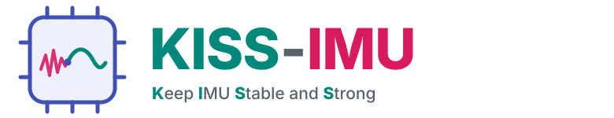
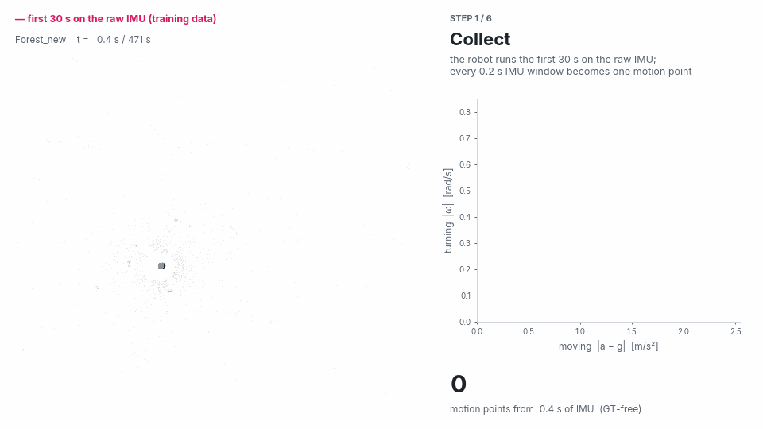
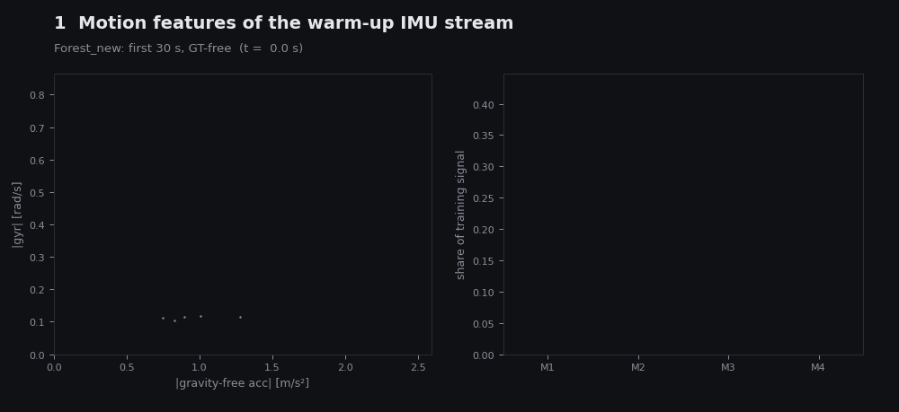

<div align="center">
  <picture>
    <source media="(prefers-color-scheme: dark)" srcset="assets/logo_dark.svg" />
    
  </picture>
  <br />
  <a href="#package-installation"></a>
  <a href="https://pytorch.org"></a>
  <a href="#docker"></a>
  <a href="#docker"></a>
  <a href="#package-pretrained-checkpoint"></a>
  <br />
  <a href="https://sparolab.github.io/research/kiss_imu/"></a>
  <a href="https://arxiv.org/abs/2603.06205"></a>
  <a href="https://arxiv.org/abs/2603.06205"></a>
  <a href="https://www.youtube.com/watch?v=cjAFROi-jG0"></a>
  <a href="#bookmark_tabs-two-versions"></a>
  <a href="https://github.com/sparolab/KISS-IMU/tree/icra2026"></a>
  <br />
  
  <p>
    <strong>[ICRA 2026] KISS-IMU: Self-supervised Inertial Odometry<br />
    with Motion-balanced Learning and Uncertainty-aware Inference</strong>
  </p>
  <p>
    🏆 IEEE ICRA 2026 Award Finalist &nbsp;·&nbsp; 🥇 IEEE-RAS Outstanding WiRA Student Paper Award
  </p>
  <a href="https://scholar.google.com/citations?user=wL8VdUMAAAAJ&hl=ko">Jiwon Choi</a>,
  <a href="https://hogyun2.github.io">Hogyun Kim</a>,
  <a href="https://scholar.google.com/citations?user=kiBTkqMAAAAJ&hl=ko">Geonmo Yang</a>,
  <a href="https://scholar.google.com/citations?user=4-5Fi9kAAAAJ&hl=ko">Juhui Lee</a>,
  <a href="https://scholar.google.com/citations?user=W5MOKWIAAAAJ&hl=ko">Younggun Cho</a><sup>†</sup>
  &nbsp;·&nbsp; <a href="https://sparolab.github.io/">SPARO Lab</a>
</div>

______________________________________________________________________

An IMU drifts, but a robot with a LiDAR already carries its own teacher. KISS-IMU lets the robot learn its IMU denoiser from **the first 30 s of the run it is on**, and then keeps running on it:

- :dart: **Data selection**: the first 30 s run on the raw IMU; the LiDAR odometry poses of that stretch are the pseudo-labels. No GT, no training set.
- :balance_scale: **Motion-balanced learning**: a GMM over motion features splits the stretch into motion regimes; effective-number weights, a frequency gate, a rare-regime boost and per-regime convergence keep rare motion from being drowned out.
- :jigsaw: **Overlap-score labels**: the stretch is re-run with the corrected IMU and every scan pair's label is re-picked among {label, re-run LO, re-run PGO} by point-cloud overlap; the model is retrained.
- :chart_with_downwards_trend: **Multi-horizon loss**: preintegration residuals over 0.5–10 s, each pair weighted by a GT-free label-vs-IMU noise fit.
- :repeat: **Learned IO in the loop**: the *running* sliding-window LiDAR-inertial PGO switches to the corrected IMU, no restart.

## :bookmark_tabs: Two versions

| | Branch | Use it to |
| --- | --- | --- |
| :new: **Online KISS-IMU** | **`main`** | use KISS-IMU the way the paper argues: **learn from the start of the run → online PGO** |
| :page_facing_up: **Paper code** | [`icra2026`](https://github.com/sparolab/KISS-IMU/tree/icra2026) · tag [`v1.0-icra2026`](https://github.com/sparolab/KISS-IMU/releases/tag/v1.0-icra2026) | **reproduce the paper**: offline training on training sequences, PVGO inference with learned uncertainty |

```bash
git clone https://github.com/sparolab/KISS-IMU.git              # online KISS-IMU
git clone -b icra2026 https://github.com/sparolab/KISS-IMU.git  # paper code
```

<details>
<summary>What changed from the paper code</summary>

| | Paper code (`icra2026`) | Online KISS-IMU (`main`) |
| --- | --- | --- |
| Training data | whole training sequences, offline | first 30 s of the **same** run, online |
| Pseudo-labels | ICP vs. PGO, overlap vote | LO poses + overlap-score label rounds, in the loop |
| Motion balancing | GMM, effective-number weights, frequency gate | same recipe, per label pair |
| Loss | fixed segments | multi-horizon, noise-weighted |
| Back-end | PVGO with learned IMU covariance | sliding-window PGO with bias states; LO weighted by the GICP Hessian, IMU by its own sample variance |

</details>

## :floppy_disk: Datasets

The examples use **[DiTer](https://sites.google.com/view/diter)** (`DiTer_os`, Ouster + IMU, `Forest_new`). One root, one directory per sequence:

```
<root>/<SEQUENCE>/
├── imu.csv              # t, gyro xyz, acc xyz
├── gt_pose.csv          # t, x, y, z, qx, qy, qz, qw (or t + row-major 3x4) — evaluation only
└── points/
    ├── data/*.bin       # float64 x, y, z, intensity; sorted names = scan order
    └── timestamps.txt   # one stamp per scan
```

`data.type` picks a profile in [`kiss_imu/data/profiles.py`](kiss_imu/data/profiles.py) (IMU columns, LiDAR→IMU extrinsics). For a new dataset add a profile and a `configs/<dataset>/data.yaml`, then **check the extrinsics** GT-free: `python3 tools/check_extrinsics.py configs/<dataset>/pgo.yaml <SEQ>` (residual LiDAR→IMU rotation and clock offset → `data.lidar_rotvec_deg`, `data.scan_time_offset`).

______________________________________________________________________

## :package: Installation

```bash
pip install -r requirements.txt     # numpy<2, scipy, pyyaml, scikit-learn, torch, small_gicp, matplotlib
```

### Docker

The published image already has every dependency.

```bash
# docker/docker-compose.yml: mount your data, e.g. /mnt/hdd/datasets:/storage1
docker compose -f docker/docker-compose.yml up -d
docker exec -it kiss-imu-ws bash    # /home/test_ws/src
```

## :rocket: Run

```bash
# learn from the first 30 s -> online PGO with the learned IO
python3 scripts/run_warmstart.py configs/diter_os/warmstart.yaml --seqs Forest_new --out runs/warmstart \
    --set data.root=/storage1/DiTer_os

# the same PGO on the raw IMU
python3 scripts/run_pgo.py configs/diter_os/pgo.yaml --seqs Forest_new --out runs/raw \
    --set data.root=/storage1/DiTer_os
```

The pipeline: raw-IMU PGO for `warmstart.warmup_s` (30 s) → pseudo-labels from its LO poses → denoiser training (GMM motion balancing, 2 overlap-score label rounds) → hand-over of the running PGO to the corrected IMU → to the end. Each sequence writes `online.txt` / `smoothed.txt` (TUM), `steps.jsonl` (per-scan log), `train*/` (each label round's model, GMM regimes in `reweight.json`) and `result.json`.

On `Forest_new` (310 m, 471 s), trained on its first 30 s:

| | ATE (aligned) | IMU-only attitude drift (60 s) | IMU-only velocity drift (10 s) |
| --- | --- | --- | --- |
| raw IMU + PGO | 0.295 m | 58.0° | 4.56 m/s |
| online KISS-IMU, hand-over after training (+171 s) | 0.250 m | 22.1° | 2.92 m/s |
| online KISS-IMU, hand-over at 30 s (released checkpoint) | **0.180 m** | 23.1° | 3.10 m/s |

The hand-over waits for the training (`warmstart.latency: measured`, 141 s here with 2 label rounds); with the released checkpoint it happens at 30 s.

Configs: [`configs/warmstart.yaml`](configs/warmstart.yaml) (warm-up, label rounds, hand-over) on [`configs/pgo.yaml`](configs/pgo.yaml) (PGO), training in [`configs/train_warmstart.yaml`](configs/train_warmstart.yaml); any key via `--set key=value`.

## :package: Pretrained checkpoint

[`checkpoints/diter_os/Forest_new/`](checkpoints/diter_os/Forest_new) is the denoiser learned from the **first 30 s of `Forest_new`**: `kiss_imu_ws30.pt` (weights + window), `train_config.json`, `reweight.json` (the GMM regimes, shares and weights), `history.json` (loss).

```bash
# replay the online run without training (hand-over at 30 s)
python3 scripts/run_warmstart.py configs/diter_os/warmstart.yaml --seqs Forest_new --out runs/ws_pretrained \
    --set warmstart.adapt=false warmstart.pretrained=checkpoints/diter_os/Forest_new/kiss_imu_ws30.pt
# or the corrected IMU from the first scan
python3 scripts/run_pgo.py configs/diter_os/pgo.yaml --seqs Forest_new --out runs/corrected \
    --set io.mode=corrected io.checkpoint=checkpoints/diter_os/Forest_new/kiss_imu_ws30.pt
```

## :toolbox: Tools

### Motion-balanced learning

<div align="center"></div>

What the learning sees in the first 30 s (IMU only, GT-free): a 0.2 s window slides over the IMU stream and its mean rate |mean ω| and mean gravity-free specific force |mean (R_yaw a − g)| become one point of the motion feature plane → GMM regimes (K by BIC), on the plane and along time → share of the training signal per regime, raw (dashed) vs. effective-number reweighted → training.

```bash
python3 tools/make_gmm_gif.py configs/diter_os/warmstart.yaml Forest_new runs/warmstart/Forest_new --out fig/gmm_balance.gif
python3 tools/make_gif.py configs/diter_os/warmstart.yaml Forest_new runs/ws_pretrained/Forest_new \
    --train checkpoints/diter_os/Forest_new --raw runs/raw/Forest_new --out fig/kiss_imu_online.gif
```

### Live view

`scripts/run_pgo.py ... --rerun spawn` streams the map, trajectory, LO quality and IMU to a [Rerun](https://rerun.io) viewer.

## Citation

```bibtex
@inproceedings{choi2026kissimu,
  title     = {KISS-IMU: Self-supervised Inertial Odometry with
               Motion-balanced Learning and Uncertainty-aware Inference},
  author    = {Choi, Jiwon and Kim, Hogyun and Yang, Geonmo and Lee, Juhui and Cho, Younggun},
  booktitle = {IEEE International Conference on Robotics and Automation (ICRA)},
  year      = {2026}
}
```

## Contributing

Issues and pull requests are welcome. Contact: Jiwon Choi (jiwon2@inha.edu).

## License

BSD 3-Clause for academic use. For commercial use, please contact the authors.
